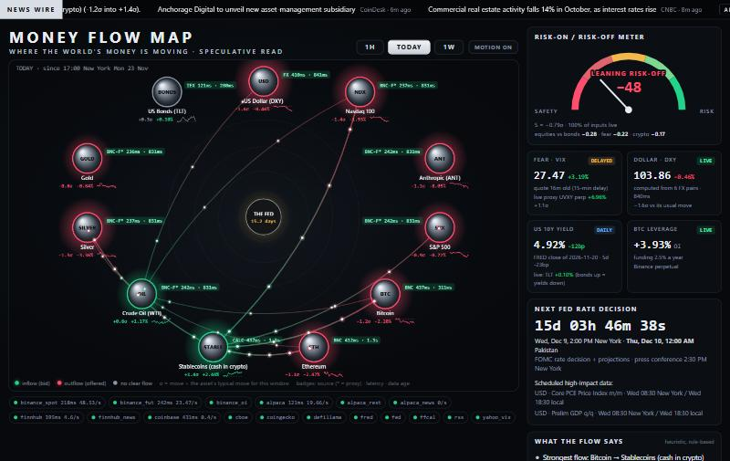

# Money Flow Map

A real-time, **heuristic** read of where money is moving across markets right now: stocks, bonds,
the dollar, gold, silver, oil, Bitcoin, Ether and stablecoins, plus whichever **single large-cap
stock** is moving most unusually at that moment (if any). It runs as **one
lightweight Python process** that listens to free, low-latency public data feeds. It serves the
read as a **local JSON API** (REST, WebSocket, SSE, webhooks) for other apps, plus an
**optional dashboard**.



> **Heuristic, not fact.** Prices are public; *flows between assets are inferred* from
> simultaneous opposite moves. Nobody can see where each dollar actually goes. Nothing here is
> advice, and nothing here can place an order: it uses market data only.

---

## Contents
1. [Quick start](#1-quick-start)
2. [What it shows](#2-what-it-shows)
3. [How the flows are computed](#3-how-the-flows-are-computed)
4. [Sources, measured latency, terms](#4-sources-measured-latency-terms)
5. [Keys and configuration](#5-keys-and-configuration)
6. [Connecting other apps (API)](#6-connecting-other-apps-api)
7. [The dashboard](#7-the-dashboard)
8. [Performance](#8-performance)
9. [Recovery after sleep or network loss](#9-recovery-after-sleep-or-network-loss)
10. [Tests and tools](#10-tests-and-tools)
11. [Limits: what is real-time and what is not](#11-limits-what-is-real-time-and-what-is-not)
12. [Project layout](#12-project-layout)

---

## 1. Quick start

```powershell
.\start.ps1
```
Or double-click **`start.bat`**. This finds Python 3.11+, installs `aiohttp` only if it is
missing, starts the service and opens the dashboard at <http://127.0.0.1:8765/>. Stop it with
Ctrl+C or by closing the window.

**It does not keep running in the background.** It stops by itself **5 minutes after the last
dashboard tab (or app) disconnects**, and also 5 minutes after a start if nobody opens it. A page
refresh is fine; the 5 minutes are there for that. Stopping is clean: the feeds stop, the history
cache is saved, the port is freed and the process exits. The log says why ("no dashboard tab or app
connected for 5 minutes: stopping"). Nothing restarts it: there is no scheduled task, startup
entry, service or watchdog. Start it again with `start.bat` when you want it.

- An app using the API keeps it alive: an open WebSocket/SSE stream, or any request (or webhook
  delivery) within the 5 minutes.
- To keep it always on: `.\start.ps1 -StayRunning`, `python -m moneyflow run --stay-running`, or
  `idle_shutdown_minutes = 0` under `[server]` in `moneyflow.local.toml`. Another delay:
  `idle_shutdown_minutes = 15` or `--idle-minutes 15`.
- A webhook-only setup (nothing reads the API) should use the always-on option. Webhooks fire only
  on events, so the service could otherwise stop between them.

```powershell
.\start.ps1 -NoDashboard        # API only (headless)
.\start.ps1 -StayRunning        # do not stop when unused
python -m moneyflow run --no-dashboard --port 8800
python -m moneyflow read --tf 1h # print the current read in the terminal
python -m moneyflow keys         # which API keys were found (values are never shown)
python tools/selftest.py         # check a RUNNING service end to end (about 270 checks)
python -m moneyflow check        # measure every source's latency (with the service stopped)
```

What to expect:
- **First start:** about 20-30 s to download 35 days of 5-minute history (measured: 22 s, and 26 s on 25 Nov).
  Binance's request budget is shared by every program on your internet connection. If others use
  it in the same minute, the service pauses until the next minute rather than use more than half of
  it, and the log says so (one first start next to a second copy took 81 s).
- **Later starts:** about 7-25 s, because history is cached in `data/` and only the missing tail is downloaded (measured: 7-21 s).
- **While loading:** nodes show **WARMING UP** until their volatility history is in.

Requirements: Windows (also works on macOS/Linux), Python 3.11+ (developed on 3.13),
`aiohttp`. `orjson` and `psutil` are used when installed. `tzdata` provides the time zones on
Windows. Everything is in `requirements.txt`.

---

## 2. What it shows

| Element | Meaning |
|---|---|
| **Node** (sphere) | An asset. **Green glow = inflow** (bid), **red = outflow** (offered), grey = no clear move. Glow strength grows with the size of the move. |
| **σ** under a node | The window's move divided by that asset's **typical move for the same window** (its z-score). +2σ is an unusually strong rise for *that* asset; it lets bonds, coins and indices be compared. |
| **%** under a node | The plain percent change over the window. |
| **Sparkline** | The path of the move over the window. |
| **Badge** (e.g. `BNC-F* 144ms · 0.4s`) | The data source, its **median latency** (exchange timestamp to receipt) and the **age of its newest data**. Green = live, amber = delayed, grey = market closed, red = stale. `*` = a proxy (e.g. a perpetual standing in for the ETF). |
| **Curved edge with moving dots** | An **inferred** flow from an outflow asset to an inflow asset in the same window. Thicker means stronger. Hover over an asset to see its arrows, or, if it has none, why not (for example "it moved −0.4σ, inside ±0.5σ, too small to count"). |
| **Notable stock** (right of the map) | The large-cap US stock whose move is most unusual in the window, with why it was picked (section 3.8). It changes with the window and the moment; when no stock clears the threshold the spot shows "none stands out now". |
| **The Fed** (centre) | Days to the next FOMC rate decision. |
| **1H / TODAY / 1W** | The window: the last 60 minutes; since **17:00 New York** yesterday (the global trading-day roll, i.e. the US close); the last 7 days. |
| **Risk-on / risk-off meter** | A −100…+100 composite of documented components (section 3). |
| **FEAR · VIX** | The VIX level. It is licensed and **15 minutes delayed**, and is labelled so. Beside it is a live 24/7 proxy, the UVXY perpetual. |
| **DOLLAR · DXY** | The ICE Dollar Index formula, computed live from six FX pairs. |
| **US 10Y YIELD** | FRED's daily close, with the date shown, plus the live TLT move as a hint. |
| **BTC LEVERAGE** | Bitcoin perpetual funding (per year) and the change in open interest over the window. |
| **Next Fed rate decision** | A countdown, shown in New York time and in your local time (this PC's time zone, or `local_timezone` in the config), plus the next high-impact releases. |
| **What the flow says** | Rule-based sentences. Each sentence carries the id of the rule that produced it (hover to see it). |
| **Strongest flows** | The top inferred edges with weight and correlation ρ. |
| **News wire** | Headlines from several feeds, newest first. Each shows its source and how long ago it was published. |
| **Status strip** | Every connector with its state, median latency and message rate. |
| **Footer** | Connection state, and "This program stops by itself 5 min after the last viewer leaves" (section 1). If the page loses the service for good it says the service may have stopped and to start it again with `start.bat`. |

Every asset reports one of these statuses:

| Status | Meaning |
|---|---|
| `live` | Receiving live data. |
| `delayed` | The source is delayed by design (the VIX level). |
| `closed` | Its market is shut. |
| `stale` | Its market is open but the feed has been silent too long: 2 min for most feeds, 10 min for IEX ETFs, which can go minutes between trades on that one exchange. A price loaded from the history cache also counts as stale until the first live message arrives. |
| `warming_up` | Not enough history for σ. A brand-new listing carries `history_from` instead. |
| `no_data` | Nothing received. |

**Delayed, cached or closed data is never shown as live.**

---

## 3. How the flows are computed

All maths is in `moneyflow/stats.py`, `moneyflow/flow.py` and `moneyflow/narrative.py`, and it is
unit-tested.

### 3.1 Price series
Every instrument keeps fixed-memory ring buffers:
- 1-minute closes for 1 day;
- 5-minute closes for 35 days;
- 5-minute traded volume, including the taker-buy part where the venue reports it.

The live price updates every tick. A step's `live` flag records whether that instrument's market
was open. History is seeded at start-up from REST and cached on disk.

### 3.2 The z-score (σ)
`z = log return over the window / σ`, where σ is the asset's **own typical move for that same kind of window**:

| Window | σ estimated from |
|---|---|
| 1H | RMS of rolling 60-minute log returns over the last 10 days. Only windows where its market was open count. |
| TODAY | **Same-clock σ**: RMS, over the previous 30 days, of the move from that day's 17:00 New York roll to the *same clock time*. At 10:00 New York it compares with 10:00 on previous days, so overnight gaps and intraday volatility patterns are handled for every asset class. In the first hour after the roll, the yardstick is the typical move of that first hour; otherwise right after 17:00 every past window would be shorter than one 5-minute step and σ would read 0. Fallback (fewer than 8 such days, e.g. a recent listing): daily realized variance from 5-minute returns, scaled to the elapsed part of the day. |
| 1W | RMS of daily (roll-to-roll) log returns over calendar days, × √7. |

- **RMS, not standard deviation:** the mean of short-horizon returns is about 0, and estimating it adds noise.
- **No information is not a zero move:** a market that was **shut for the whole window** gets a missing z. HYG at 3 a.m. has no "1H" move.

### 3.3 Volume confirmation (where volume exists)
- **Relative volume:** volume in the window ÷ the median volume of the same window on the previous 20 days. For 1W it is the previous 4 weeks.
- **Net taker flow (USD):** taker-buy quote volume − taker-sell quote volume, from Binance 1-minute klines. It shows how much aggressive buying versus selling hit the book.
- **IEX volume** (Alpaca) is a *sample*, about 2-3% of US volume, so only relative volume is used from it.

### 3.4 Flow edges (inferred)
For every pair with **A offered** (`z_A ≤ −θ`) and **B bid** (`z_B ≥ +θ`) in the same window:

```
weight(A→B) = sqrt(|z_A| · z_B) · (1 − ρ_AB) / 2
```
- `ρ_AB` is the correlation of A's and B's step returns **inside the window**: 1-minute steps for 1H, 5-minute for TODAY, hourly for 1W.
- A rotation looks like one asset sold while the other is bought, step by step (ρ → −1). That keeps the full weight.
- Assets that merely moved together (ρ → +1) get **no edge**.
- Unknown ρ counts as 0 (factor 0.5).
- So does the stablecoin share against BTC and ETH. The share is computed from their prices, so its correlation with them (about −1) is arithmetic, not evidence of a rotation. Such an edge shows no ρ.
- **Which edges are drawn.** First, every asset that has a qualifying edge (weight ≥ 0.3) keeps its single strongest one. Then the strongest of the rest are added, up to 16 in all and 5 per asset. Until 25 Nov 2026 the caps applied to everything, so an asset sold into the same haven as five stronger sellers lost its only arrow. That was often gold (section 10).
- Defaults: θ = 0.5σ, minimum weight 0.3, at most 16 edges and 5 per asset beyond each asset's strongest.

**An asset without an arrow** is always explained (hover over it on the map, or `no_edge` in the API):

| Code | Plain words |
|---|---|
| `neutral` | It moved less than θ (±0.5σ): too small to count as money moving in or out. |
| `no_counterpart` | It was sold (or bought), but nothing on the map moved the other way by θ or more. |
| `co_moved` | Its best partner moved in step with it (ρ > 0): moving together is not a rotation, so the weight stays under 0.3. |
| `too_weak` | Its strongest possible edge weighs under 0.3. |
| `closed`, `warming_up`, `no_data`, `not_live` | No usable move in this window (market shut all window, too little history, no data, or stale data). |

The strongest edge is the "strongest flow". It is a statement about *simultaneous opposite
moves*, not about where any particular dollar went.

### 3.5 Risk-on / risk-off composite (−100…+100)
Each component is in σ units, clipped to ±4. Weights are in the config (`[risk]`):

| Component | Formula | Weight |
|---|---|---|
| Stocks vs Treasuries | z(S&P 500) − z(TLT) | 0.25 |
| Fear | −z(UVXY perpetual, live VIX proxy) | 0.20 |
| Crypto | mean(z(BTC), z(ETH)) | 0.15 |
| Credit | z(HYG) − z(IEF) | 0.10 |
| Dollar | −z(DXY) | 0.10 |
| Stablecoin share | −z(stablecoin share of crypto) | 0.10 |
| Gold (haven demand) | −z(gold) | 0.05 |
| Tech leadership | z(Nasdaq 100) − z(S&P 500) | 0.05 |

- `S` = the weighted mean of the available components. `score = round(100 · tanh(S / 1.5))`.
- Labels: ≤ −60 RISK-OFF, −60…−20 leaning risk-off, ±20 mixed, 20…60 leaning risk-on, ≥ 60 RISK-ON.
- Missing inputs, such as HYG/IEF outside US hours, drop out and the weights are renormalised. `coverage` reports the live share of weight.
- Because z-scores remove scale, a leveraged or futures-based proxy (UVXY ≈ 1.5× short-term VIX futures) gives a z close to that of what it tracks.

### 3.6 Special series
- **US Dollar (DXY).** `50.14348112 · EURUSD^−0.576 · USDJPY^0.136 · GBPUSD^−0.119 · USDCAD^0.091 · USDSEK^0.042 · USDCHF^0.036`, computed on every OANDA tick from Finnhub.
  - **Validated live:** over 16 minutes and 323 timestamp-matched quotes, the computed value minus ICE's DXY (via Yahoo, 10 min delayed) was **mean +0.0007, sd 0.0024, max 0.011**, at a DXY of about 103.9.
  - The history comes from ICE's DXY itself.
- **Stablecoins (cash in crypto).** The share of total crypto market cap held in USD stablecoins:
  `S / (S + NS₀ · B(t)/B₀)`.
  - `S` is the supply from DefiLlama. `NS₀` is the non-stable cap from CoinGecko.
  - `B` is a cap-weighted basket of live Binance prices (BTC, ETH, BNB, SOL, XRP).
  - The share moves **mechanically** when crypto prices fall, even with no new money. So the hover and narrative also show the **supply change** (mints − burns), which is the real "new cash" signal.
- **US Bonds (TLT).** A *stitched* series. While US markets are open it uses TLT on IEX. Outside them it uses the TMF perpetual's index ÷ 3 (TMF is 3× TLT). At the open it snaps back to the real price, so the opening gap is real.
  - **Without an Alpaca key** there is no live TLT. The service then downloads TLT's 5-minute (60 days) and 1-minute (2 days) bars from Yahoo's chart API at start-up, so the proxy is anchored on TLT's real last close. From then on the node follows TMF ÷ 3 around the clock, and the hover says so.
  - The 1-minute series (one day) and the 5-minute series (35 days) are kept consistent: the 1-minute chain starts from the 5-minute value at a 5-minute boundary, and a gap in the proxy's data never drops its move.

### 3.7 "What the flow says"
These are deterministic rules in `narrative.py`; each bullet carries its rule id. Examples:
- **Bonds bid while stocks fall** (z ≥ 1 vs ≤ −1): "classic safety trade".
- **Stocks and bonds both sold**: "Treasuries are not working as a haven".
- **Dollar bid while stocks fall.**
- **Gold sold with stocks and crypto**: "broad liquidation".
- **Fear spike**: VIX proxy ≥ 2σ.
- **Stablecoin share up while crypto is down**: "crypto traders moving to cash", qualified by the supply change.
- **Ether lagging Bitcoin.**
- **Open interest vs price**: deleveraging, new shorts, new longs or short covering.
- **Negative funding.**
- **Oil shocks.**
- **Tech lagging.**
- **Notable stock**: the stock in the slot, its move and how unusual it is.
- **Plus:** the risk regime, the Fed countdown, the next US high-impact release, and caveats about proxies and closed markets.

### 3.8 The notable-stock slot
The fixed nodes are asset classes. A single stock is not one: on the reference map "Anthropic" was
simply the stock that stood out at that moment. So one slot (`[stocks] slots`, 0 to 5) shows **the
large-cap stock whose move is most unusual in the window**, and only when one clears the rule. It
can be a different stock in 1H, TODAY and 1W, and it can be empty.

- **Universe.** The configured large caps (138 S&P 100 and Nasdaq-100 names plus big ADRs, editable
  in `[stocks] universe`) that have a Binance 24/7 TradFi perpetual: **78 of them** on 25 Nov 2026.
  The API lists the other 60 (`stocks.not_listed`: MA, PG, PEP, CVX, ...). The perpetual is what
  makes the chosen stock readable around the clock, like the Nasdaq-100 and S&P 500 nodes, with no key.
- **The screen** runs every 5 minutes and is cheap:
  - one bulk request returns every last price (all 817 perpetuals in 50 KB, weight 2);
  - each stock's hourly bars are fetched once (20 days, weight 2) and topped up hourly (weight 1).
  - For each window and stock:

    ```
    r     = ln(price now / price at the window start)
    σ     = same clock: RMS of the same window's move on each of the previous 20 days
            (1H: the same clock hour; TODAY: the same time since 17:00 New York; 1W: daily × √7)
    z     = r / σ
    rvol  = the window's quote volume / the median of the same on previous days
    score = |z| · √clip(rvol, 0.5, 4)      (unusual volume strengthens a move, thin volume weakens it)
    ```
  - **Rule:** a stock qualifies with **|z| ≥ 2 and score ≥ 2.5**; the highest scores fill the slots.
    The API shows the five best candidates in every case, picked or not (`stocks.candidates`).
- **The chosen stock becomes a full node.** Its 35-day history and its live 1-second index price
  are loaded within seconds of the pick. Its z on the map comes from the same estimators as every
  other node; the screen's numbers only choose it, and the hover shows both. A stock no longer
  picked keeps its live feed for 2 hours (`keep_s`) in case it comes back, then it is dropped.
- **Seen live on 25 Nov 2026 (pre-market):**
  - TODAY: **DELL**, −9.2% since 17:00 New York on 4.1× its usual volume (screen −2.9σ, map −3.3σ),
    after a 12.4% fall in Tuesday's session (Alpaca), an arrow into bonds, the dollar and stablecoins;
  - 1H: **WMT** (−3.0σ for that pre-market hour, 6.7× volume);
  - 1W: none (best: ZS +18% but only +1.4σ, its weekly swings being large).

---

## 4. Sources, measured latency, terms

### 4.1 What feeds each node

| Node | Real-time source (default) | Reference / fallback | Hours |
|---|---|---|---|
| Nasdaq 100 | Binance **QQQUSDT** perpetual, *index price* (Binance's fair price of QQQ, 1 s) | QQQ on Alpaca IEX | 24/7 (weekends = perp price discovery) |
| S&P 500 | Binance **SPYUSDT** perpetual, index | SPY on IEX | 24/7 |
| Notable stock (slot) | Binance **TradFi perpetual** of the picked stock, index (e.g. DELLUSDT) | | 24/7 |
| Gold | Binance **XAUUSDT** perpetual, index | GLD (IEX), PAXG (Binance spot) | 24/7 |
| Silver | Binance **XAGUSDT**, index | SLV | 24/7 |
| Crude oil (WTI) | Binance **CLUSDT**, index | USO | 24/7 |
| US Bonds (TLT) | **TLT on Alpaca IEX** (mid quote) in US hours | TMF perpetual index ÷ 3 otherwise | stitched 24/7 |
| US Dollar (DXY) | **Computed** from 6 OANDA FX pairs (Finnhub websocket) | UUP on IEX | FX hours (Sun 17:00 – Fri 17:00 NY) |
| Bitcoin, Ethereum | Binance spot trades (BTCUSDT, ETHUSDT) | Coinbase BTC-USD / ETH-USD (the "Coinbase premium") | 24/7 |
| Stablecoins | Computed: DefiLlama supply ÷ CoinGecko market cap, moved by live Binance prices | | 24/7 |
| VIX tile | Cboe delayed quote and Yahoo quote (both **15 min delayed**) | live proxy: Binance **UVXYUSDT** perpetual | VIX hours |
| Credit (risk input) | HYG and IEF on IEX | | US regular hours |

Context sources:
- **FRED:** DGS10, DGS2 and the HY spread (daily).
- **federalreserve.gov:** the FOMC calendar.
- **Forex Factory weekly export:** scheduled US releases.
- **Binance REST:** open interest.
- **Headlines:**
  - Alpaca news stream (real-time, filtered to the map's tickers and macro themes).
  - Finnhub news.
  - RSS: FinancialJuice, FT, Bloomberg, CNBC, FXStreet, CoinDesk, Cointelegraph, The Block and the Fed's press releases.

**Why perpetuals for indices and commodities?** In November 2026 Binance lists "TradFi
perpetuals" that trade around the clock. Measured on 24 Nov 2026:

| Perpetual | 24h turnover |
|---|---|
| QQQUSDT | $1.2B |
| XAUUSDT | $3.0B |
| ANTUSDT | $1.1B |
| CLUSDT | $0.7B |
| SPYUSDT | $0.34B |

On Saturday 21 November QQQUSDT still traded $192M and XAUUSDT $684M. Their index price keeps
moving at weekends and re-prices when CME futures reopen on Sunday evening. They are therefore the
best free 24/7, low-latency proxy for these markets. During US hours the hover shows the basis
against the real ETF on IEX.

How closely does the index track the real ETF? Measured against IEX trades on 24 Nov 2026:

| When | QQQ | SPY | ANT |
|---|---|---|---|
| First 3 minutes after the open (median) | +11 bp | +13 bp | +16 bp |
| 09:50 New York | −0.4 to +4.5 bp | about +6 bp | −2 to +19 bp |

At the open the index lagged a falling market. ANT, a new listing, is the noisiest. So **%
changes from the perpetuals can differ from the ETF's own by about 0.1% around the open**.

### 4.2 Measured latency
Latency is **receive time − the exchange's own timestamp**, measured on this PC (home connection,
Pakistan) with the clock corrected by NTP. Measured on 24 Nov 2026; marketing claims were not used.
> The PC clock ran **0.95-0.99 s fast**. Uncorrected, every source would look about 1 s slower.
> The service measures this offset itself (SNTP) and corrects all ages.

| Source (what is used) | Median | p90 | Rate | Notes |
|---|---|---|---|---|
| Binance spot trades (BTC, ETH) | **89-126 ms** | ~140 ms | 13-17/s per coin | 95 ms in the first probe |
| Binance futures, liquid trades (BTC, XAU) | **95 ms** | 170-245 ms | 15-44/s | `/market/stream` path |
| Binance futures, TradFi perp trades | 110-245 ms | 245 ms | 1-6/s | pushed in 250 ms batches |
| Binance futures index/mark price (`markPrice@1s`) | **130-156 ms** | ~165 ms | 1/s per symbol | the price used for TradFi nodes |
| Alpaca IEX (quotes / trades), pre-market | **~110 ms** | ~113 ms | SPY quotes 11/s | |
| Alpaca IEX, US regular session (14:34 UTC) | **132-139 ms** | ~145 ms | TLT 52/s, IEF 27/s, HYG 17/s quotes at the open | every ETF symbol |
| Binance spot during the US session | **~106 ms** | ~108 ms | BTC 50/s, ETH 36/s | |
| Binance futures index/mark, US session | **144-154 ms** | ~160 ms | 1/s per symbol | |
| Finnhub OANDA FX, US session | **336-400 ms** | 536-632 ms | 1.5-3/s per pair | busier than pre-market |
| Evening check, 15:15 UTC (20:15 Pakistan) | Binance 215-230 ms, IEX ~120 ms, FX ~420 ms | | | from the running service's own badges |

Network latency varies through the day on a home connection: Binance's median doubled between
13:30 and 15:15 UTC. The dashboard shows each source's *current* median latency, so read the
table as typical ranges.
| Finnhub OANDA FX (6 pairs) | **260-345 ms** | 380-505 ms | 1-2/s per pair | DXY inputs |
| Coinbase full ticker | 120 ms | 130 ms | 19/s (BTC) | the service uses the batched channel, which updates every ~5 s by design |
| Hyperliquid trades (optional) | 300-450 ms | ~530 ms | | not used by default |
| Yahoo streamer FX (rejected) | 0.9-1.1 s | ~2 s | | unofficial |
| Yahoo `^VIX` | **902 s (15 min)** | | | licensing delay |
| Yahoo `DX-Y.NYB` (ICE DXY) | **602 s (10 min)** | | | used only for the DXY *history* |
| Cboe delayed VIX JSON | 15 min | | | shows the prior close until 09:30 New York |

| Polled source | Freshness when fetched | Poll interval |
|---|---|---|
| CoinGecko `/global` | data 5-7 min old | 5 min |
| DefiLlama stablecoins | live total; history daily | 60 min |
| FRED DGS10 | on 24 Nov the latest close was 20 Nov (1-2 business days) | 6 h |
| FinancialJuice RSS | newest headline 1-2 min old | 3 min |
| CNBC RSS | ~6 min | 3 min |
| Finnhub general news | 15-45 min | 2.5 min |
| Alpaca news stream | real-time | stream |

Run `python -m moneyflow check --seconds 120` to measure again. It writes a JSON report to `data/`.

### 4.3 Tested and rejected (and why)

| Candidate | Result |
|---|---|
| **Kraken** websocket (real FX pairs) | This network's DNS **refuses** `ws.kraken.com` / `api.kraken.com` ("Query refused"). Not usable here. |
| **Binance futures, legacy `/stream` path** | Connects but **delivers nothing** (Nov 2026). `/market/stream` (and `/public/stream` for book data) work. |
| **Hyperliquid HIP-3** `xyz:DXY`, `xyz:VIX` | Listed but **zero volume and open interest**: frozen prices. The index perps (`xyz:XYZ100`, `xyz:SP500`) are liquid. The connector is included as an optional fallback, off by default. |
| **VIX real-time** | The index is licensed. Every free quote found (Cboe, Yahoo) is 15 min delayed. The tile shows the delayed level, labelled with its age, and the live UVXY perpetual as the real-time direction. |
| **Yahoo streaming** | Unofficial. FX about 1 s (Finnhub is 3-4× faster). Not used for live prices; the chart API is used only for history (DXY, and TLT/HYG/IEF when there is no Alpaca key) and a second delayed VIX quote. |
| **JBlanked** (key present) | Every calendar endpoint answers **HTTP 401 "requires credits"** with this key. Not used. |
| **Finnhub** economic calendar and FX candles | HTTP 403 on the free plan. |
| **Spot BTC/ETH ETF flows** | Farside's pages answered this program's HTTP client with a **Cloudflare bot challenge** (403). Bot checks are respected, not worked around, so the connector is off. DefiLlama's ETF routes are 404; SoSoValue needs a key; CoinGlass is paid. No ETF flows by default. |
| **MT5 / Exness** | MetaTrader 5 is installed on this PC, but the other projects only hold Exness *web-terminal indicators* (no data connector). A live MT5 feed would need the terminal running, which is heavy, and it gives broker CFD quotes. Not used; it could be added as a connector. |
| **Binance spot EURUSDT** for FX | Only EUR exists (no GBP/JPY/CAD/SEK/CHF). Not enough for the DXY. |

### 4.4 Terms and rate limits (summary)
- **Binance**
  - Public market data needs no key.
  - REST weight limits: 6,000/min (spot) and 2,400/min (futures). The service watches the used-weight header and pauses at 50%.
  - Up to 1,024 streams per websocket; Binance closes each connection every 24 h, and the service reconnects.
  - The notable-stock screen adds about 110 weight an hour (one bulk price call every 5 min at weight 2, plus one small hourly-bar request per stock an hour), and 160 once at start-up. A picked stock joins the open stream with `SUBSCRIBE`, without reconnecting (measured).
  - Market data only. API Terms of Use: <https://www.binance.com/en/terms>
- **Alpaca Basic (free)**
  - Real-time IEX feed; **one** connection per stream type; 200 REST calls/min.
  - For personal, non-redistributed use.
  - If another app holds the stream (error 406), the service retries every 5 min and polls the latest trades over REST meanwhile.
- **Finnhub free**
  - 60 REST calls/min, 50 websocket symbols, attribution "Data provided by Finnhub".
  - Uses 6 symbols and 1 news call per 150 s.
- **CoinGecko public API:** 5-30 calls/min. Uses 1 per 5 min. Attribution: "Data provided by CoinGecko".
- **DefiLlama:** free, no key. Uses 1 call per hour, plus history twice a day.
- **FRED:** 120 calls/min per key. Uses 3 calls per 6 h.
- **Cboe delayed quotes and Yahoo:** delayed data for personal use. Yahoo's API is unofficial, so it is used sparingly: VIX once a minute while VIX is calculated, DXY history at start, and (only without an Alpaca key) two history requests per ETF at start.
- **federalreserve.gov:** public domain. Polled once a day.
- **Forex Factory weekly export:** polled every 2 h.
- **RSS:** publishers' public feeds. Each is polled every 3 min with ETag / If-Modified-Since. Headlines link back to the publisher.

---

## 5. Keys and configuration

Keys are optional; each one unlocks one source:

| Key | Unlocks | Without it |
|---|---|---|
| `ALPACA_KEY_ID`, `ALPACA_SECRET` | TLT/HYG/IEF and the ETF reference quotes; the real-time news stream | Bonds follow the TMF proxy around the clock, anchored on TLT's real close (Yahoo history at start-up); credit drops out of the risk meter |
| `FINNHUB_KEY` | the live DXY, Finnhub news | No dollar node |
| `FRED_API_KEY` | the 10Y yield tile and curve | No 10Y tile |

Put them in a git-ignored `.env` (copy `.env.example`), **or** point the config at an existing
`.env` instead of copying:

```toml
# moneyflow.local.toml (git-ignored)
[keys]
env_files = [".env", "../my-other-project/.env"]

[general]
local_timezone = "Asia/Karachi"   # the second clock; "" (the default) = this PC's own zone
```
Only the four key names above are read from those files. Other secrets in them, such as e-mail
passwords or exchange trading keys, are never loaded. Values are never printed, logged, cached or
served:
- `python -m moneyflow keys` shows only *set / missing*;
- every log line and every error string goes through a redaction filter;
- a test checks that no key appears in any API response.

**Configuration** is TOML:
- `moneyflow/default.toml` documents every option.
- Override it in `moneyflow.toml`, or in `moneyflow.local.toml` (git-ignored) for this PC.
- `[[series]]` entries merge by `id`. To add an asset (for example the disabled `copper`, `iwm`
  or `openai` series), set `enabled = true`, or add a new entry with a `source` and `symbol`.
- Connectors are switched in `[connectors.*]`.
- Auto-stop is set in `[server] idle_shutdown_minutes` (default 5; 0 = keep running), or per start
  with `--stay-running` / `--idle-minutes N` (`start.ps1 -StayRunning`).
- The notable-stock slot is set in `[stocks]`: `slots` (0 switches it off, up to 5), `z_min` and
  `score_min` (the rule), `scan_interval_s`, `keep_s`, `positions` (where each slot sits on the
  map) and `universe` (your own list of tickers replaces the default one).

```toml
[[series]]
id = "copper"
enabled = true

[connectors.hyperliquid]
enabled = true

[stocks]
slots = 2          # show up to two notable stocks
z_min = 2.5        # and only really unusual moves
```

---

## 6. Connecting other apps (API)

The service listens on `http://127.0.0.1:8765` (localhost only). Everything is read-only JSON.

| Endpoint | Returns |
|---|---|
| `GET /api/snapshot?tf=today` | Everything for one window (`1h`, `today`, `1w`), or `tf=all` for all three |
| `GET /api/nodes?tf=1h` · `/api/nodes/{id}` | Assets (`bonds usd gold silver oil ndx spx btc eth stables`, plus `stock1` when a stock is picked; aux: `vix_proxy hyg ief`) |
| `GET /api/edges?tf=` · `/api/risk?tf=` · `/api/narrative?tf=` · `/api/tiles?tf=` | Parts of the read |
| `GET /api/history/{id}?grid=5m&hours=24` | Stored closes of one series (5m: 35 days, 1m: 1 day), each `[step end time, close, market open 1/0]`, for drawing your own charts. `stock1` gives the stock now in that slot (`&tf=` picks the window, default `today`) |
| `GET /api/news?limit=30` · `/api/fed` · `/api/events` | Headlines, next FOMC decision, scheduled releases |
| `GET /api/sources` · `/api/health` | Connector states and latency; process CPU/RAM, clock offset; `idle`: open streams, seconds idle and seconds until auto-stop |
| `GET /api/schema` | The JSON Schema (`moneyflow/schema/snapshot.schema.json`) |
| `WS /ws?tf=today` | A `{"type":"snapshot","tf":..,"data":{..}}` message every second. Send `{"tf":"1h"}` to switch. |
| `GET /sse?tf=today` | The same messages as Server-Sent Events (`event: snapshot`) |
| Webhooks | POSTs on `regime_change`, `strongest_flow_change`, `extreme_move` (|z| ≥ 3), optional `snapshot` |

Examples:

```powershell
Invoke-RestMethod "http://127.0.0.1:8765/api/risk?tf=1h"
(Invoke-RestMethod "http://127.0.0.1:8765/api/snapshot?tf=today").narrative.text
curl.exe -N "http://127.0.0.1:8765/sse?tf=today"
```

```python
from moneyflow.client import MoneyFlowClient          # standard library only
c = MoneyFlowClient()                                   # http://127.0.0.1:8765
snap = c.snapshot("today")
print(snap["risk"]["label"], snap["risk"]["score"])
for e in snap["edges"][:3]:
    print(e["from"], "->", e["to"], e["weight"])
```
See `examples/client.py` (REST and `--stream`) and `examples/webhook_receiver.py`.
`client.stream()` reconnects by itself (1 s doubling to 30 s) if the service restarts.

```js
const ws = new WebSocket("ws://127.0.0.1:8765/ws?tf=today");
ws.onmessage = (m) => { const s = JSON.parse(m.data).data; console.log(s.risk.label, s.edges[0]); };
```

**Snapshot shape** (abridged; the full schema is in `/api/schema`):

```json
{"schema": "moneyflow.snapshot/1", "generated_at": "2026-11-24T14:13:34.340Z", "timeframe": "today",
 "window": {"start": "...", "end": "...", "label": "since 17:00 New York Mon 23 Nov"},
 "nodes": [{"id": "ndx", "label": "Nasdaq 100", "price": 638.67, "change_pct": -2.10, "z": -2.01,
            "sigma_pct": 1.06, "direction": "outflow", "status": "live", "age_s": 0.15, "latency_ms": 121,
            "source": {"id": "binance_fut", "name": "Binance USD-M perpetual", "symbol": "QQQUSDT", "proxy": true},
            "volume": {"rvol": 1.92, "net_taker": -15307890, "taker_buy_ratio": 0.48},
            "reference": [{"symbol": "QQQ", "source": "alpaca", "price": 635.76, "status": "closed"}],
            "spark": [-0.04, 0.03, "..."], "no_edge": null},
           {"id": "oil", "label": "Crude Oil (WTI)", "z": -0.4, "...": "...",
            "no_edge": {"code": "neutral", "text": "No arrow: it moved -0.4σ, inside ±0.5σ, too small to count as money moving in or out."}},
           {"id": "stock1", "label": "DELL (notable stock)", "short": "DELL", "z": -3.29, "change_pct": -9.22, "...": "...",
            "slot": {"index": 1, "symbol": "DELL", "perpetual": "DELLUSDT", "universe": 78,
                     "why": "DELL -9.20% today (-2.9σ) on 4.1× its usual volume: the most unusual move among 77 large caps (screen score 5.8).",
                     "screen": {"z": -2.92, "rvol": 4.06, "score": 5.85}}}],
 "edges": [{"from": "spx", "to": "stables", "weight": 1.53, "share": 0.18, "corr": -0.65}],
 "stocks": {"slots": 1, "universe": 78, "screened": 77, "rule": {"z_min": 2.0, "score_min": 2.5},
            "picks": [{"slot": 1, "symbol": "DELL", "z": -2.92, "score": 5.85, "why": "..."}],
            "candidates": [{"symbol": "DELL", "...": "..."}, {"symbol": "MDB", "...": "..."}], "not_listed": ["MA", "PG", "..."],
            "note": "..."},
 "risk": {"score": -83, "label": "RISK-OFF", "coverage": 1.0, "components": ["..."]},
 "narrative": [{"id": "bonds_bid_safety", "text": "Bonds are bid (yields falling) while stocks fall: a classic safety trade.", "level": "down"}],
 "tiles": {"vix": {"level": 29.59, "status": "delayed"}, "dxy": {"level": 103.86}, "us10y": {"value": 4.92, "date": "2026-11-20"}},
 "fed": {"decision_at": "2026-12-09T19:00:00.000Z", "countdown": "15d 04h 55m", "when_ny": "Wed, Dec 9, 2:00 PM New York"},
 "news": [{"title": "...", "source": "FinancialJuice", "age_s": 105, "tags": ["FED"]}],
 "sources": [{"id": "binance_spot", "state": "connected", "latency_ms_median": 89.6, "msgs_per_s": 13.4}],
 "meta": {"heuristic": true, "clock": {"offset_ms": -983}}}
```

**Webhooks** (`moneyflow.toml`):
```toml
[webhooks]
targets = [{ url = "http://127.0.0.1:9000/hook", events = ["regime_change", "extreme_move"] }]
min_interval_s = 60
```

**Sharing on your LAN** is off by default. It needs both `server.host = "0.0.0.0"` and a
`server.token`; the config refuses one without the other. Requests whose Host header is not
localhost are refused, which protects against DNS rebinding.

---

## 7. The dashboard

A single page in `moneyflow/static/`: plain HTML, CSS and JavaScript, no framework, and **no
external requests** (no CDNs, no web fonts).

**Rendering**
- The network is drawn into an off-screen canvas **only when data changes** (once a second).
- The visible canvas copies it and draws the moving particles at **≤ 30 fps**.
- Animation **stops while the tab is hidden**, when MOTION is switched off, or when Windows asks
  for reduced motion. The news wire pauses too.

**Interaction**
- Hover a node (or **tap** it on a touch screen) to see its price, source, data age and latency, plus a larger chart of the move.
- On a **phone** the map re-flows into two columns with shorter labels and compact badges. The legend moves below the map.
- The news wire shows headlines immediately and loops seamlessly. New headlines join at the end of a loop, so it never jumps back.
- The hover card also shows:
  - the move and σ in all three windows, and the typical 1σ move;
  - relative volume and net taker flow;
  - funding and open interest;
  - the reference quotes with their basis;
  - the stablecoin supply change and the DXY's FX legs.
- The status strip shows every connector. The footer shows the PC clock correction, market hours,
  and the service's own CPU and RAM.
- The window choice and the motion setting are remembered in the browser.

**The page's own cost.** The page measures itself: type `__mfPerf.report()` in the browser
console. On 24 Nov 2026 it measured:

| Work | Time |
|---|---|
| One animation frame (blit + about 100 particles) | 0.25 ms |
| Redrawing the network when data arrives (once a second) | 1.4 ms |
| Updating the panel (once a second) | 1.1 ms |
| Parsing each ~87 KB update | 1.0 ms |

At the 30 fps cap that is about **11 ms of script per second, roughly 1% of one core**, plus the
browser's own compositing, which the page cannot see. With MOTION off it is about 3.5 ms/s. A
hidden tab only parses updates and draws nothing.

---

## 8. Performance

Measured on this laptop (Intel i7-10510U, 4 cores / 8 threads, 16 GB, Windows 10, Python 3.13)
with all default sources live:

CPU is given two ways: % of one logical core (Task Manager's *Details* tab) and % of the whole
machine (its *Processes* tab, 8 logical cores).

| Run (24 Nov 2026, US session) | CPU, one core: mean / median / p95 | CPU, whole machine | RAM (working set) | Private |
|---|---|---|---|---|
| **Headless, final config** (8 min) | **2.5% / 1.6% / 6.2%** | **0.31%** | **75-83 MB** | 62-67 MB |
| **+ 1 WebSocket client** (8 min; the load of one open dashboard: a full ~87 KB snapshot every second) | **3.7% / 3.1% / 7.8%** | **0.46%** | 78-82 MB | 61-65 MB |
| Headless, first config, first hour after the open (10 min; also streamed IEF/HYG bid/ask, since dropped) | 3.9% / 3.1% / 9.3% | 0.49% | 75-79 MB | 60-63 MB |
| **With the notable-stock slot** (25 Nov, pre-market, 10 min; 2 picked stocks live, 1 dashboard open) | **2.65%** / — / 6.2% | **0.33%** | 81-87 MB | — |

The large-cap screen costs no measurable CPU (one 50 KB request every 5 minutes, about 0.3 s each, and a small hourly top-up) and about 5 MB of memory.

- **25-minute soak** (after the verification fixes, with the dashboard tab connected): 50 samples, 30 s apart.
  - Memory flat: 75.6 MB at the start, 74.2 MB at the end, 78.6 MB at most.
  - CPU averaged 3.6% of one core (at most 7.5%).
  - Every asset was live in every sample, with zero source errors.
- **Start to ready:** 9-21 s from the history cache.
- **Threads:** 18.
- **Peaks:** occasional single-second peaks of 12-22% of one core come from the periodic jobs:
  - parsing RSS (9 feeds every 3 min);
  - DefiLlama's 0.6 MB stablecoin list (hourly);
  - re-estimating σ (once a minute);
  - saving the history cache (every 30 min).
- **Load at the US open:** about 180 messages/s across all feeds. Binance BTC/ETH trades alone
  were ~90/s. `trade_stream = false` under `[connectors.binance_spot]` drops them in exchange for
  BTC/ETH prices up to ~2 s old.
- **Browser side:** see section 7 (measured in the page).

Why it is light:
- **One asyncio process.** No busy loops: every wait has a timeout.
- **Light streams.** Binance futures use 1 s index prices and 1-minute klines rather than every
  trade, Coinbase uses its 5-second batch channel, and Alpaca news is filtered.
- **Cached computation.** σ is recomputed once a minute, correlations every 10-30 s, volume
  baselines every 30-120 s.
- **Snapshots only when wanted.** They are built for the 1-second push only when a client is
  connected, otherwise on request.
- **Fixed memory.** Ring buffers of about 0.2 MB per instrument.
- **History cached on disk.**

Measure it yourself:
```powershell
python tools/measure_resources.py --minutes 10              # headless
python tools/measure_resources.py --minutes 10 --clients 1  # with one dashboard/WebSocket client
```

---

## 9. Recovery after sleep or network loss

- **Dropped or silent feeds.**
  - Every websocket reconnects with exponential back-off and jitter: 1 s doubling to 60 s, reset after a healthy minute.
  - A feed that goes silent beyond its idle limit counts as dead. That catches half-open TCP connections after Wi-Fi loss.
    - The limit is 45 s for Binance, 2 min for FX and 10 min for IEX while their market is open.
    - It is an hour while their market is closed: silence is normal then.
  - aiohttp heartbeat pings check the peer.
- **Sleep or hibernation.**
  - A watchdog notices the wall clock jumping (more than 25 s in a 5 s tick).
  - It then clears the DNS cache, re-syncs the clock by NTP and **kicks every connector** into an immediate reconnect.
  - After gaps over 2 minutes it **downloads the missing history** for every instrument.
  - With no dashboard open, it stops by itself within 5 minutes of the PC waking (auto-stop,
    section 1). An open dashboard reconnects within that time and keeps it running.
- **Pollers** back off on errors (10 s doubling to 15 min) and recover by themselves.
- **Rate limits:** a `429 Too Many Requests` answer makes that source wait at least 5 minutes (or its `Retry-After`) before asking again.
- **Restarts reuse fresh data:** the slow sources are cached in `data/cache/`, so frequent restarts stay far from the sources' limits:
  - market cap 10 min, stablecoin supply 1 h, FRED 6 h, calendar 2 h;
  - the FOMC calendar is also cached.
- **No network at start-up:** history is retried every 1 min (then 2, 4 … up to 15 min) until every instrument has it.
- **Another app holds Alpaca's single stream:** the free plan allows one, and Alpaca refuses the second with code 406. The service waits 5 min between retries and meanwhile polls the latest IEX trades over REST every 20 s.
  - It waits for Alpaca's login answer before subscribing, so a refusal is never mistaken for bad keys.
  - Tested live: the bonds node stayed **live** through the REST fallback, at a data age of about 20 s.
- **Finnhub also allows one stream per key.** A second copy of this service, or another app using the same key, takes the slot, and Finnhub refuses the first with HTTP 429 (seen live on 24 Nov 2026).
  - Any websocket refused with 429 waits at least 2 minutes before retrying instead of hammering, and its status says why.
  - **Run one copy at a time;** other apps should read this service's API rather than open their own Finnhub or Alpaca streams.
- **Closing the window or Ctrl+C / Ctrl+Break:** a graceful stop that saves the history cache. Tested: exit code 0 in 1.2 s, cache written.
- **History** is saved to `data/cache/` every 30 minutes and on exit.
- **Tests:** `tests/test_reconnect.py` checks:
  - reconnection after server drops, after silence and after a `kick()`;
  - poller back-off;
  - the resume path;
  - that the sleep gap is re-downloaded, not left flat. That bug was caught here: the 1-second tick had already filled the gap with the pre-sleep price.

**Sleep, tested live** (24 Nov 2026, US session). The running service was **frozen for 150 s**
(process suspended, which is what it experiences during sleep), then resumed:

| When | What happened |
|---|---|
| On resume | The log says `wall clock jumped 151s (sleep/hibernate?): resyncing and reconnecting`. The clock is re-synced by NTP and every stream reconnects. |
| 2 s later | Nodes honestly show **STALE**, with data ages of 126-133 s. |
| 20 s later | `history gap since 15:07:21Z refilled`. |
| 40 s later | Every stream has reconnected (2 connects each) and all 11 nodes are **LIVE** with data ages of 0.1-5 s. |

The same test was repeated **in place on the running service** after the verification fixes.
It detected a 154 s jump and all six streams reconnected. **All 11 assets were live again 12 s
after waking**, and the gap's history was back-filled 15 s after.

Real network loss was not simulated on this PC: that needs admin rights and would cut your
connection. It is covered by the drop and silence tests and by the same reconnect code.
Closing the console window uses the same graceful-stop handler as Ctrl+Break, which was tested;
closing the window itself was not.

---

## 10. Tests and tools

```powershell
python -m pytest              # unit, API, reconnect and offline-replay tests (no network needed)
```
- **Unit tests:**
  - key loading and redaction;
  - New York trading-day roll across DST, NYSE holidays and early closes, FX and VIX hours;
  - the ring buffers;
  - the stitched bonds series: the 1- and 5-minute series agreeing, gaps in the proxy, and bonds without an Alpaca key in US hours;
  - σ estimators on exact synthetic series;
  - edge weights (including series built from each other), which edges are kept, the plain-language reason for every asset without an arrow, and the risk composite;
  - **every node, gold and the stock slot included, as the strongest outflow and the strongest inflow, in all three windows**, through the real engine (`tests/test_every_node.py`: 66 forced cases);
  - auto-stop: the idle timer (a tab connects, disconnects, a refresh within the delay, two viewers, API polling, a webhook delivery, the opt-out, never opened), and the real `serve()` stopping by itself and freeing its port, or staying up while an app streams (`tests/test_idle.py`);
  - the notable-stock screen on exact synthetic hourly bars (σ, volume ratio, score, the rule, "may be none"), the universe filter, and the slot as a full node (snapshot, schema, narrative, history id);
  - narrative rules (including the reference screenshot's read);
  - Fed calendar parsing;
  - RSS/Atom and news de-duplication;
  - config merging and validation.
- **API:** REST endpoints validated against the JSON Schema, WebSocket and SSE streams, the Host
  guard and token, headless mode, and no keys in any response.
- **Offline replay:** `tests/data/replay_sample.jsonl.gz` holds real frames recorded on 24 Nov 2026
  around the US open, replayed through the real connector parsers, the engine and the snapshot
  builder. The test checks prices, the DXY formula, latency and the schema.
- **Tools:**
  - `tools/selftest.py`: checks a **running** service end to end.
  - `tools/record.py`: record live frames for replay.
  - `tools/check_latency.py` (= `python -m moneyflow check`): latency and freshness report.
  - `tools/measure_resources.py`: CPU and RAM report.
  - `tools/replay_flows.py`: replays the flow map over the cached history (offline) and reports how often each asset had an arrow in each window, and when it had none, which rule left it out.

**What `tools/selftest.py` checks:**
- every endpoint and error code, and the JSON Schema for every window;
- each asset's status, data age, z and σ;
- that every edge runs from an outflow to an inflow;
- the risk range, the Fed date, news de-duplication, and that connectors are up;
- latency, CORS, the Host guard, and the WebSocket and SSE streams;
- **prices against independent sources:**
  - Binance REST (BTC, ETH, the index prices);
  - Yahoo's ICE DXY and VIX;
  - CoinGecko's stablecoin share;
  - Alpaca's latest TLT trade and the SPY basis.

**Second test round (24-25 Nov 2026):**
- **Independent recomputation** (`tools/verify_against_exchange.py`) for BTC, ETH, Nasdaq 100, S&P 500, gold and oil, from 35 days of raw Binance 5-minute data:
  - stored history matched 10,079 steps (worst 0.0125%, on the still-forming latest step);
  - a 2-hour restart gap had been back-filled with real data;
  - σ (1H, TODAY, 1W), z-scores and % changes are identical to the recomputation;
  - the strongest edge's correlation matched (0.110 vs 0.109).
- **Derived series on real data:**
  - stitched bonds match TLT's 5-minute closes in US hours (max 0.006%);
  - overnight, each of 715 steps equals the TMF index move ÷ 3 exactly;
  - the computed DXY stayed within 0.012 of ICE's;
  - the stablecoin share stayed within ~0.5% (relative) of the share implied by CoinGecko's fresh totals, which lag 2.5-7.5 min.
- **Load:**
  - 20 WebSocket and 10 SSE clients plus 40 REST requests/s for a minute: 1,845/1,845 requests OK (p50 1.6 ms, p95 9.6 ms);
  - every client got its 1/s update, and CPU stayed at 4-11% of one core;
  - 5 minutes of streamed messages (299, validated for all three windows): 0 schema failures, 0 duplicates, max gap 1.3 s.
- **Security:**
  - path-traversal attempts are all 404, with nothing leaked;
  - foreign Host headers are refused;
  - write methods get 405;
  - malformed, binary and oversized WebSocket input neither crashes nor blocks anything, and a stalled client doesn't stall others;
  - no key appears in any response.
- **More recovery and calendar tests:**
  - the network down for a while, then back;
  - a dead webhook target;
  - a start with no data at all;
  - Thanksgiving (US shut, FX and crypto live), a Saturday (FX shut) and the 13:00 early close;
  - a real daily roll replayed from the cache;
  - token mode in the browser.
- **Live market transitions, 24 Nov 2026:**
  - **US close (21:00 UTC):** within 20 s bonds switched from TLT to TMF ÷ 3 and carried on from TLT's last price with no jump. HYG/IEF and the ETF reference quotes went to "closed", and the caveats appeared.
  - **Daily roll (17:00 New York, 22:00 UTC):** TODAY switched to "since 17:00 New York Tue 24 Nov" by 22:00:02, with z-scores for all 11 assets throughout (σ > 0, nothing "warming up"). A copy with keys and one without agreed on bonds after the roll (+0.027% vs +0.026%, same σ).
  - The dollar went "stale" for about 4 minutes after 17:00 New York, when FX quotes pause for the daily rollover. That is correct.
- **Optional parts tested live:**
  - the Hyperliquid connector, whose Nasdaq-100 perp read z −1.08 against −1.13 from Binance's QQQ contract;
  - the copper, Russell 2000 and OpenAI nodes;
  - `start.bat` (normal start, and a busy port).
- **Dashboard:**
  - phone, tablet and desktop layouts;
  - memory flat over hundreds of forced re-renders;
  - 0.9% of one core at the full 30 fps.
- **Fixed in this round:**
  - **TODAY's σ read 0 for ~5 minutes after every daily roll** (17:00 New York, 22:00 UTC in winter), blanking the z-scores. It was found by replaying a real roll from the history cache;
  - **quiet markets would have caused reconnect storms:** IEX is silent overnight and at weekends, and FX from Friday to Sunday, so the streams would have reconnected every 2-10 minutes. While their market is closed the silence limit is now an hour, and the heartbeat still checks the link. Finnhub pings every 60 s, measured;
  - the dashboard now says when a token is missing or wrong, instead of "stream lost";
  - Finnhub (one stream per key) refused a second copy with HTTP 429 and the service retried every few seconds; 429 refusals now wait ≥ 2 min;
  - the Host check was case-sensitive;
  - `client.stream()` now reconnects after a restart;
  - labels and badges now make room for same-row neighbours on tablets;
  - **bonds' TODAY move differed by 0.1% between two copies of the service.** Found by running one with keys and one without, side by side. The one-day 1-minute bonds series restarted from TLT's raw close at the start of its window, dropping the proxy's moves since the close. It now starts from the 5-minute series, at a 5-minute boundary where the proxy's own close is known, and a gap in the proxy's data no longer drops a move. The two series now agree within 0.0002% outside US hours (in US hours both are TLT's real bars);
  - **without an Alpaca key the bonds node was blank.** It now takes TLT's history from Yahoo's chart API and follows the TMF proxy from TLT's real close. With and without keys, the TODAY baselines agreed within 0.013% and the moves within 0.007 points;
  - **...and in US hours it would have stayed frozen at that close.** A price carried forward from history counted as "trading" during market hours, so the bonds series kept TLT's old close instead of following its proxy. A carried price now counts as trading only once live data has arrived;
  - **"Bitcoin → Stablecoins, ρ −1.00" was drawn as the strongest kind of rotation.** The stablecoin share is computed from Bitcoin's and Ether's prices, so that correlation is arithmetic. It now counts as unknown (section 3.4), which halves such an edge's weight;
  - **for up to a minute after the daily roll, σ from the previous day was still served** (cached), so z-scores were about 6× too small (Bitcoin's σ read 2.46% instead of 0.43% until 22:00:47). Seen in the live roll; everything cached is now dropped when the trading day changes;
  - after a restart in the 17:00 New York lull the dollar read "stale" for 11 minutes with no reason given. One FX pair had not ticked yet; the Finnhub source now names such pairs.

**Verification pass on 24 Nov 2026, during US hours.**

- **Self-test:** 268 of 268 checks passed.
- **Failure scenarios, run live:**

  | Scenario | Result |
  |---|---|
  | Busy port | Clear message, exit 1 |
  | `check` while the service runs | Refuses with an explanation |
  | Second instance (Alpaca stream refused) | REST fallback kept bonds live |
  | No API keys at all | Runs on the keyless sources, says why each key-based one is off |
  | Process frozen 150 s (sleep) | Recovered within 40 s |
  | Ctrl+Break | Graceful stop |
  | 25-minute soak | See section 8 |
- **Bugs this pass found and fixed, each now covered by a test:**
  - Cached history could count as "live".
  - A refused Alpaca login was taken for bad keys, which delayed retries by an hour.
  - REST-polled prices were counted as network latency.
  - The stablecoin share could start empty for 10 minutes.
  - Webhooks fired a false regime change at start-up.
  - A new listing showed "warming up" without saying why.
  - Thin IEX ETFs went stale every few minutes.
  - The phone layout overlapped.
  - The news wire jumped back on every headline.

**Third round (25 Nov 2026): "why is Anthropic always on the map, and why does gold never get an arrow?"**
- **Anthropic** was a fixed node, yet it was only the stock that stood out on the reference map. It
  is replaced by the notable-stock slot (section 3.8). On its first live screen (pre-market) it
  picked DELL for TODAY, −9.2% on 4.1× volume, cross-checked against Alpaca (DELL closed Tuesday
  −12.4%) and Binance's REST index (within 0.01%). It picked WMT for 1H, and nothing for 1W.
- **Gold, the evidence.** The flow map was replayed over the cached history with the dashboard's
  own engine (every 15 minutes for 24 h, every hour for 7 days):

  | Gold has an arrow | 1H (24 h) | TODAY (24 h) | TODAY (7 d) | 1W (7 d) |
  |---|---|---|---|---|
  | Before the fix | 37% | 47% | 46% | 100% |
  | After | 42% | 61% | 51% | 100% |

  - The data path was sound: gold's price matched Binance's REST index, and its z-score and status
    were normal.
  - Most arrow-less moments are **legitimate**: gold moved less than ±0.5σ (34 of 38 in TODAY over 24 h).
  - **A selection flaw** removed the rest. With 5 arrows per asset, the havens (bonds, stablecoins,
    the dollar) filled up with stronger sellers, and gold (often the weakest seller) lost its only
    arrow: 9 of 51 arrow-less TODAY moments in 24 h. Every clearly sold or bought asset now keeps its
    strongest arrow, as on the reference map, where bonds and stablecoins each take 6-7 arrows.
  - **Drawing**: the arrows were drawn (pixel-checked on the canvas), but a typical one was 2 px wide
    at half opacity. They are now thicker and brighter. On phones, arrows between neighbours in a
    column were hidden under the spheres and labels; they now bow clear of them.
  - Hovering an asset now lists its arrows or says exactly why it has none (section 3.4). On
    25 Nov 11:35 UTC gold had arrows in all three windows (1H: the window's strongest, gold → stablecoins).
  - `tests/test_every_node.py` proves every node, gold and the stock slot included, can be the
    strongest outflow and inflow in each window.
- **Also found and fixed in this round:**
  - the stock screen's weekly σ included the current day, which is the move being measured;
  - the hover mixed up two stocks when the slot held different ones in different windows;
  - the phone layout kept stale positions when the slot appeared on switching windows.

**Auto-stop, tested live on 25 Nov 2026.** A 1-minute delay was used unless noted. The service was
watched through the process list and open ports only, because a request would itself count as use.

| Scenario | What happened |
|---|---|
| Started, never opened (default 5 min; a copy without keys) | Started 12:03:46 UTC. At 12:08:49: "not opened for 5 minutes: stopping"; cache saved; exited at 12:08:50, code 0. |
| Dashboard opened, kept open, then closed | Opened 12:09:45 and still running 100 s later. Tab closed 12:11:41. At 12:12:43: "no dashboard tab or app connected for 1 minute: stopping"; exited at 12:12:45, code 0; port free 65 s after the close. |
| An app streaming the API for 150 s | 148 snapshots received; the service stayed up throughout, long past the delay. The app left at 12:15:47; the service stopped at 12:16:52 and exited at 12:16:54, code 0. |
| `--stay-running` (given together with `--idle-minutes 1`) | Still running 100 s after start with nobody connected ("auto-stop off"). |
| Afterwards | No Python process left on the PC, no port listening. No scheduled task (of 196), Startup-folder item, Run/RunOnce registry entry or Windows service refers to the app. |

---

## 11. Limits: what is real-time and what is not

| Truly real-time (≤ 0.4 s) | Real-time **proxies** | Delayed or slow (labelled) |
|---|---|---|
| Bitcoin, Ether (Binance spot) | Nasdaq 100, S&P 500, the notable stock, gold, silver, oil: **Binance perpetual index prices**, not the cash index or ETF. Weekend prices are perpetual price discovery. | **VIX level: 15 min delayed** (licence) |
| Binance perpetual index and mark prices (1 s) | Bonds outside US hours: **TMF perpetual ÷ 3** (thin, about $2M/day) | **10Y yield: FRED daily close**, 1-2 business days old |
| DXY computed from OANDA FX (~0.3 s) | VIX direction: **UVXY perpetual** | **Stablecoin supply: hourly**; total crypto cap from CoinGecko is 5-10 min old (moved live by Binance prices) |
| TLT/HYG/IEF on IEX during US hours (~0.13 s) | Stablecoin share between CoinGecko polls: moved by a 5-coin basket | Headlines: depends on the publisher (FinancialJuice ~minutes; Finnhub 15-45 min) |
| Alpaca news stream | | Open interest: polled each minute; ETF flows: not available for free (see 4.3) |

More caveats:
- **IEX is one exchange.** Its prices are real-time, but its volume is a sample.
- **Outside US hours** the HYG/IEF credit component drops out of the risk meter.
- **After a restart, the dollar needs a first tick from all six FX pairs.** Usually that takes
  seconds. In the rollover lull just after 17:00 New York it took up to 11 minutes (24 Nov). Until
  then the node shows ICE's last DXY, marked stale, and the Finnhub source lists the silent pairs
  ("no tick yet from …").
- **σ adapts to the recent regime.** After a volatile month the same % move earns a smaller σ.
- **Edges are inference.** Several assets falling while one rises will draw edges from all of
  them. The correlation weighting keeps co-moving pairs out, but it cannot prove causation.
- **Fed dates** come from the Fed's own page. An unscheduled meeting appears only once the Fed
  publishes it.
- **The notable-stock screen is a screen.** Its σ comes from 20 days of hourly bars (same clock),
  and its volume is the 24/7 perpetual's, not the stock exchange's. It only chooses the stock; the
  node's own z uses the full estimators, so the two can differ (the hover shows both). Outside US
  hours a stock's perpetual trades thinly, and its overnight moves are perpetual price discovery
  (the map's caveat says so). Only large caps with a Binance perpetual (78 of the 138 configured)
  can be picked.

---

## 12. Project layout

```
moneyflow/
  cli.py          run / read / keys / check
  engine.py       builds series from the config, runs connectors, seeds history, builds snapshots
  series.py       ring buffers, instruments, DXY, stablecoin share, stitched series
  stats.py        windows, σ estimators, volume, correlation, sparklines
  flow.py         edges, risk composite
  narrative.py    "what the flow says" rules
  fed.py          FOMC calendar parser and countdown
  news.py         RSS/Atom parsing, headline book
  server.py       REST, WebSocket, SSE, webhooks, dashboard
  clock.py        NTP-corrected clock, New York day roll, NYSE/FX/VIX calendars
  keys.py         .env loading (whitelist) and redaction
  history.py      on-disk grid cache
  latency.py      the `check` command
  client.py       a small Python client
  connectors/     binance, alpaca, finnhub, coinbase, hyperliquid, pollers (Cboe, CoinGecko,
                  DefiLlama, FRED, Fed, Forex Factory, Farside, RSS, Yahoo)
  static/         the dashboard (index.html, app.js, style.css)
  schema/         snapshot.schema.json
  default.toml    every option, documented
tests/            pytest suite + data/ (FOMC page excerpt, recorded frames)
tools/            record.py, check_latency.py, measure_resources.py
examples/         client.py, webhook_receiver.py
start.ps1 / start.bat
```
